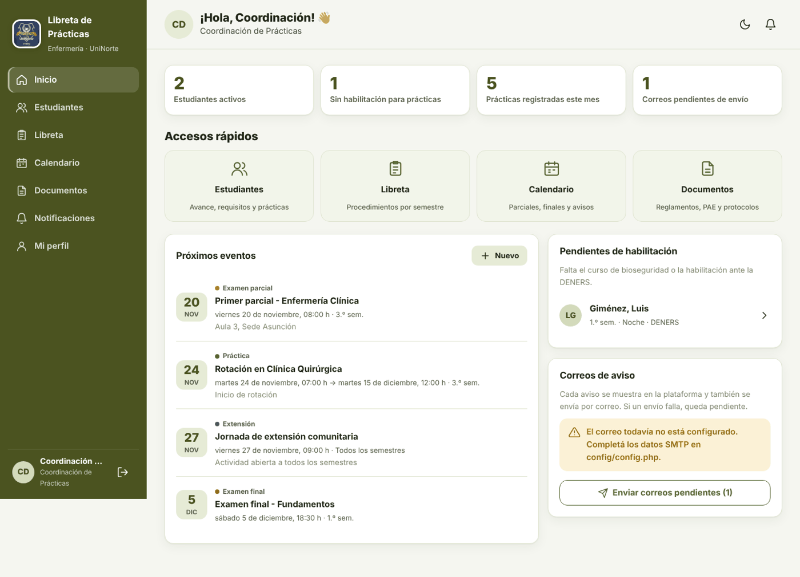
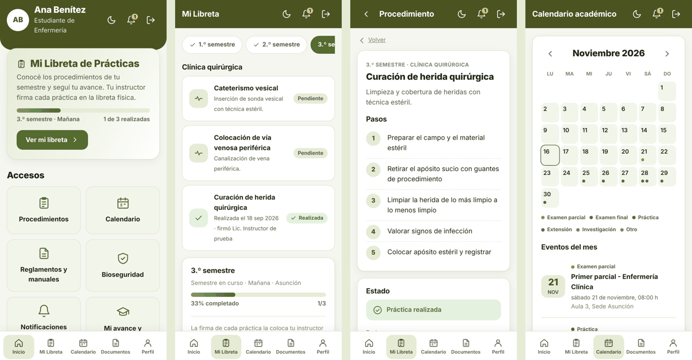
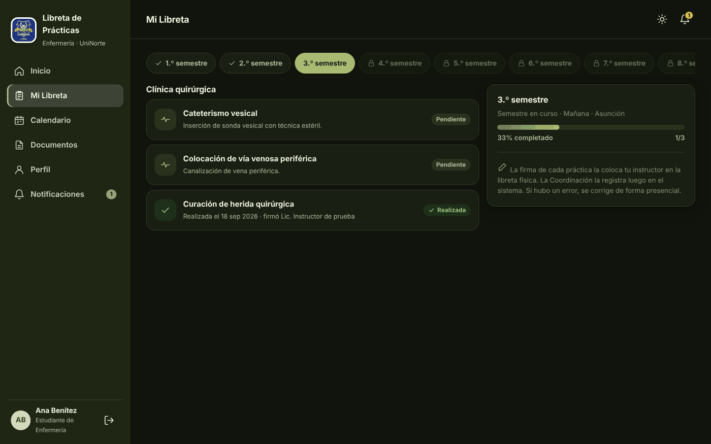

# Plataforma Académica · Carrera de Enfermería (UniNorte)

Plataforma web para la Carrera de Enfermería de la Universidad del Norte: **Libreta Digital de Prácticas**, calendario académico con avisos, documentos de consulta (reglamentos, manuales PAE, guías y protocolos) y seguimiento del avance de cada estudiante.

Funciona en computadora y celular, con **modo claro y oscuro**.

> Proyecto integrador · Ingeniería Informática · Universidad del Norte · Grupo 04

## ▶ [Probar la app](https://centurionbrisa643-prog.github.io/plataforma-enfermeria/)

**https://centurionbrisa643-prog.github.io/plataforma-enfermeria/**

Se abre en el navegador, en computadora o celular, sin instalar nada. En la pantalla de ingreso hay botones con las **cuentas de prueba** (administrador y estudiantes). Es una versión de demostración: los cambios se guardan solo en el navegador de cada persona y se pueden reiniciar con "Reiniciar datos". La versión completa, con PostgreSQL y envío de correos, se instala como se explica más abajo.



| Celular | Libreta en modo oscuro |
|---|---|
|  |  |

---

## Funcionalidades

### Estudiante
- **Mi Libreta:** consulta de los procedimientos de cada semestre, organizados por área, con sus pasos numerados.
- Ve cuáles prácticas ya fueron **realizadas** (fecha e instructor que firmó) y su porcentaje de avance.
- Solo ve los semestres habilitados: el siguiente se abre cuando aprueba el actual.
- Estado de sus requisitos: **curso de bioseguridad** y **habilitación DENERS**.
- Calendario de parciales, finales, prácticas y actividades.
- Documentos de consulta: reglamentos, manuales PAE, guías y protocolos de bioseguridad.
- Notificaciones dentro de la plataforma y por correo.

### Administrador (Dirección y Coordinación de Prácticas)
- Alta y gestión de estudiantes por **sede, turno y semestre**.
- Marca los requisitos (bioseguridad y DENERS); sin ellos no se pueden registrar prácticas.
- **Aprueba el semestre** y el sistema habilita el siguiente automáticamente.
- Registra cada práctica que el instructor **firmó en la libreta física** (y puede anularla si hubo un error).
- Carga los procedimientos de la libreta por semestre y área.
- Crea, modifica y cancela eventos del calendario; los estudiantes alcanzados reciben el aviso.
- Sube documentos en PDF y avisa a los estudiantes.
- Reenvío de correos pendientes.

### Notificación doble
Cada aviso queda en la plataforma (campanita) y se envía por correo. Si el correo falla, queda pendiente y se reintenta.

---

## Tecnologías

| Capa | Tecnología |
|---|---|
| Base de datos | PostgreSQL (administrada con pgAdmin 4) |
| Servidor | PHP 8.0 o superior, PDO |
| Interfaz | HTML, CSS y JavaScript (sin frameworks), diseño adaptable |
| Correo | Cliente SMTP propio (`includes/smtp.php`), sin Composer |

---

## Instalación en Windows

### 1. Requisitos
- **PostgreSQL** (incluye pgAdmin 4).
- **PHP 8.0 o superior.** Sirve el de **XAMPP** (`C:\xampp\php`).
- **Visual Studio Code** (opcional, para editar).

### 2. Descargar
Botón verde **Code → Download ZIP** y descomprimir, o:
```bash
git clone https://github.com/centurionbrisa643-prog/plataforma-enfermeria.git
```

### 3. Iniciar (forma rápida, con XAMPP)
Doble clic en **`1-iniciar.bat`** y escribir la contraseña de PostgreSQL.
El script crea la base `enfermeria_db` con datos de ejemplo la primera vez y abre **http://localhost:8000**.
No cerrar la ventana negra mientras se usa la página.

### 3-bis. Iniciar (forma manual)
1. En pgAdmin 4: crear la base `enfermeria_db` → Query Tool → abrir `sql/enfermeria_db.sql` → **F5**.
2. En `config/config.php`, poner la contraseña de PostgreSQL en `DB_PASS`.
3. En `php.ini`, activar `extension=pdo_pgsql` y `extension=pgsql`.
4. En la carpeta del proyecto:
   ```bash
   php -S localhost:8000 router.php
   ```
5. Abrir **http://localhost:8000**.

> Volver a ejecutar `sql/enfermeria_db.sql` borra todo y deja los datos de ejemplo limpios.

---

## Usuarios de prueba

| Rol | Correo | Contraseña |
|---|---|---|
| Administrador (Dirección) | direccion@enfermeria.test | Admin2026! |
| Administrador (Coordinación de Prácticas) | coordinacion@enfermeria.test | Admin2026! |
| Estudiante · 3.º semestre, habilitada | ana.benitez@enfermeria.test | Estudiante2026! |
| Estudiante · 1.º semestre, sin DENERS | luis.gimenez@enfermeria.test | Estudiante2026! |

Son cuentas de demostración de la base local. Los procedimientos y documentos cargados son ejemplos.

---

## Usar la app desde el celular u otra computadora

| Archivo | Para qué |
|---|---|
| `1-iniciar.bat` | Usar la página solo en la PC: http://localhost:8000 |
| `2-compartir-wifi.bat` | Abrirla en un celular conectado al **mismo Wi-Fi** (muestra la dirección, p. ej. `http://192.168.1.25:8000`) |
| `3-compartir-internet.bat` | Genera un **link público** `https://….trycloudflare.com` para usarla desde cualquier lugar. Queda copiado y guardado en `link-para-compartir.txt` |

- Abrir uno a la vez.
- El link público funciona mientras la PC esté prendida con esa ventana abierta, y cambia cada vez que se abre.

---

## Envío de correos

Mientras no se configure, los avisos se ven en la plataforma y los correos quedan pendientes.

1. En `config/config.php`: `SMTP_HABILITADO = true` y los datos de la cuenta (con Gmail, usar una **contraseña de aplicación**).
2. PHP en Windows necesita certificados: descargar `cacert.pem` de curl.se y en `php.ini` poner `openssl.cafile = "C:\ruta\cacert.pem"`.
3. Los pendientes se envían desde el botón **"Enviar correos pendientes"** (Inicio del administrador) o con `php tareas/enviar_correos.php`.

---

## Estructura

```
plataforma-enfermeria/
├── sql/enfermeria_db.sql      ← base de datos y datos de ejemplo
├── config/config.php          ← conexión a PostgreSQL y correo
├── includes/                  ← conexión, sesión, roles, notificaciones, diseño
├── assets/                    ← estilos, scripts y logo
├── admin/                     ← estudiantes, ficha del estudiante, procedimientos
├── login.php  inicio.php  libreta.php  procedimiento.php
├── calendario.php  documentos.php  notificaciones.php  perfil.php
├── storage/documentos/        ← PDFs subidos (no accesibles directamente)
├── tareas/enviar_correos.php  ← reintento de correos
├── docs/capturas/             ← imágenes de este README
├── router.php                 ← servidor de desarrollo de PHP
└── *.bat                      ← arranque rápido en Windows
```

---

## Seguridad

- Contraseñas encriptadas (bcrypt) y control de perfil en cada página.
- Consultas preparadas (PDO) contra inyección SQL.
- Protección CSRF en todos los formularios.
- Bloqueo de un minuto tras 5 intentos fallidos de ingreso.
- Los PDF solo se entregan a usuarios con sesión iniciada.
